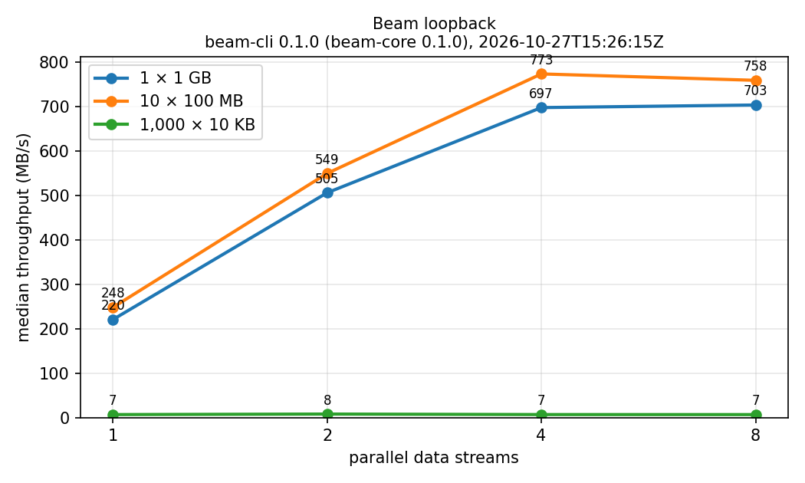

# Beam

**AirDrop for Android ↔ Windows:** fast, end-to-end encrypted file and clipboard
sharing that works even with no shared Wi-Fi network and no internet.

> **Status: in development.** Phone ↔ laptop transfers work on the same
> Wi-Fi network (the Android app, the Windows app and the CLI). Transfers
> with no shared network come next. Follow progress in
> [docs/SPEC.md](docs/SPEC.md).

## Repository layout

| Folder | What's in it |
|---|---|
| `core/` | `beam-core` (Rust): protocol, crypto, transfer engine, resume, mDNS |
| `core-ffi/` | UniFFI wrapper exposing `beam-core` to Kotlin |
| `cli/` | `beam-cli`: send / receive / discover from a terminal |
| `desktop/` | Windows desktop app (Tauri v2, React + TypeScript) |
| `android/` | Android app, Kotlin + Jetpack Compose |
| `bench/` | Benchmark scripts, results and charts |
| `docs/` | Spec, protocol, design decisions, learnings |

## Building

Requires stable Rust (installed via [rustup](https://rustup.rs)). On Windows,
also install the Visual Studio C++ Build Tools.

```bash
cargo test --workspace
```

## Desktop app (Windows)

```bash
cd desktop
npm install
npm run tauri dev
```

It sits in the tray, shows nearby devices, takes files by drag-and-drop or
Explorer's **Send to → Beam**, and asks before accepting anything (an
always-on-top popup with the verification code). It works with the CLI and
with other copies of the app. See [desktop/README.md](desktop/README.md).

## Android app

```bash
cd android
./gradlew assembleDebug
```

This builds the Rust library for each Android ABI with `cargo-ndk`,
generates its Kotlin bindings, and builds `app/build/outputs/apk/debug/app-debug.apk`.
It needs the Android SDK and NDK, JDK 21 and `cargo-ndk`: see
[android/README.md](android/README.md).

Share photos or files to **Beam** from any app (or pick them in Beam), then
tap a nearby device. Received files go to `Download/Beam`. To pair with the
desktop app, open **Pair a phone** on the laptop and scan its QR code from
**Devices → Pair with a laptop**; the two then trust each other and can find
each other in "trusted only" mode.

## Trying it from the command line (same network)

Every connection is end-to-end encrypted with Noise XX. On first run each
device creates a key pair in its config folder (`%APPDATA%\Beam` on Windows).
Files are sent over 4 parallel encrypted connections by default
(`--streams N` to change it). If the connection drops, the sender reconnects
for up to 60 s and resumes where it left off.

On one computer, start a receiver. It announces itself on the local network
(mDNS):

```bash
cargo run --release -p beam-cli -- --name "My Laptop" receive --dir ./inbox
```

On another computer on the same Wi-Fi, list nearby devices and send by name:

```bash
cargo run --release -p beam-cli -- discover --seconds 5
cargo run --release -p beam-cli -- send --to "My Laptop" photo.jpg notes.txt
```

`--to` also takes a device id (`80b4-eac6-82ed-d3d3`) or an address
(`192.168.1.20:9000`). Windows Firewall asks once to let `beam-cli` use the
network: allow it on private networks.

Both terminals show the same 6-digit **verification code**. The receiver asks:
`[y]es`, `[n]o`, or `[t]rust`. Trust remembers the sender's key and accepts
its future transfers automatically.

**Visibility** (`receive --visibility …`), like AirDrop:

| Mode | Who sees it | Who can send |
|---|---|---|
| `everyone` (default) | Everyone nearby, for 10 minutes, then trusted only | Anyone; you're asked each time |
| `trusted` | Only trusted devices (others see an anonymous, changing entry) | Trusted devices only |
| `off` | Nobody | Nobody |

To try two separate devices on one machine, give each its own identity with
`--config-dir`:

```bash
cargo run --release -p beam-cli -- --config-dir ./device-b --name Device-B send --to 127.0.0.1:9000 photo.jpg
```

Other commands:

| Command | What it does |
|---|---|
| `beam-cli identity` | Show this device's id (fingerprint) and public key |
| `beam-cli trust add <public key> --name N [--auto-accept]` | Trust a device by its public key |
| `beam-cli trust list` | List trusted devices |
| `beam-cli trust remove <id>` | Stop trusting a device (takes effect immediately, even for a running receiver) |
| `beam-cli receive --pair` | Also print a one-time pairing code (valid 5 minutes) |
| `beam-cli pair '<beam://pair?… code>'` | Pair with the device that printed or showed that code: both then trust each other |

To send between two machines, use the receiver's LAN IP address. The wire
format is described in [docs/PROTOCOL.md](docs/PROTOCOL.md).

### Checking the encryption with Wireshark

1. Install [Wireshark](https://www.wireshark.org/download.html). On Windows,
   keep **Npcap** selected in the installer and tick **"Support loopback
   traffic"**.
2. Start capturing on **"Adapter for loopback traffic capture"** (or your
   Wi-Fi adapter if the devices are on different machines). Use the capture
   filter `tcp port 9000`.
3. Create a text file with an easy-to-spot line, such as
   `BEAM-SECRET-MARKER` repeated many times, and send it as above.
4. Stop the capture and right-click any packet → **Follow → TCP Stream**.
   - In phase 2 you'll see only random-looking bytes: no file name, no device
     names, no marker text.
   - Search with **Edit → Find Packet → String → "BEAM-SECRET-MARKER"**
     (search in "Packet bytes"). It finds nothing.
5. For contrast, check out the `phase 1` commit and repeat. The file name,
   device names and the marker are all readable in the TCP stream.

The test `nothing_readable_crosses_the_wire` in `core/tests/transfer.rs`
checks the same thing automatically, using a recording proxy.

## Performance

Loopback, release build, median of 5 runs (this measures the software, not a
network). See [bench/](bench/README.md) for the method and the raw data.



Memory stays flat whatever the file size: peak memory per process is in
`bench/raw_results.csv`. Reliability is tested by
`chaos_fifty_disconnects_during_a_1_gb_transfer`, which cuts every connection
50 times during a 1 GB transfer and checks that the file still arrives
identical.
